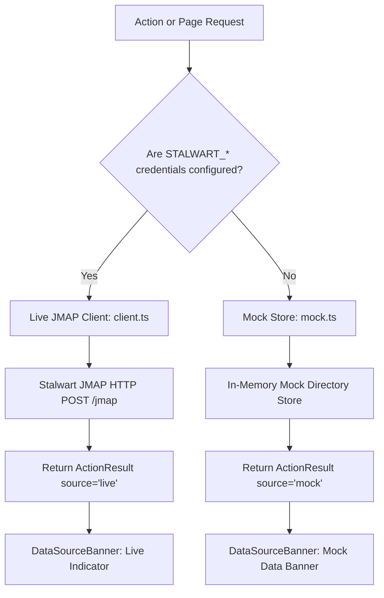

# 01 — System Architecture & Infrastructure

## 1. Overview & Purpose

**mailwart** is an administrative console designed for operators managing a modern [Stalwart Mail Server](https://stalw.art/) deployment. It fills the gap between low-level MTA configuration and day-to-day email directory operations by providing:

- Multi-domain directory and mailbox management.
- CPanel-grade email routing, catch-all handling, and forwarders.
- Automated Cloudflare DNS management and DNS health verification.
- Seamless, zero-password Roundcube Webmail single sign-on (SSO).
- An integrated AI Copilot with 48 automated administrative tools.
- A 10-point email deliverability testing suite with blacklist monitoring.
- Role-based access control with domain ownership and admin impersonation.

### Non-Goals
- **Not an in-app email client:** mailwart does not render inboxes or compose interfaces; Roundcube handles all end-user email reading and sending.
- **Not a replacement for Stalwart Admin:** Low-level ACME certificates, network socket bindings, rate limit rules, and MTA queues are deep-linked to the native Stalwart Admin UI.

---

## 2. Container Topology & Docker Compose

The production deployment consists of three co-located containers managed via Dokploy Docker Compose, interfacing with external Traefik and Stalwart services.

```
                           ┌────────────────────────────────────────┐
                           │          Host / VPS Environment        │
                           │                                        │
                           │   ┌────────────────────────────────┐   │
                           │   │         Traefik Proxy          │   │
                           │   │    (dokploy-network bridge)    │   │
                           │   └───────────────┬────────────────┘   │
                           │                   │                    │
        ┌──────────────────┼───────────────────┼────────────────────┼──────────────────┐
        │                  │                   │                    │                  │
        ▼                  ▼                   ▼                    ▼                  ▼
┌───────────────┐  ┌───────────────┐   ┌───────────────┐    ┌───────────────┐  ┌───────────────┐
│ email-manager │  │   roundcube   │   │ mailwart-pg   │    │ stalwart-mail │  │ Other Compose │
│ (Next.js 16)  │  │ (Apache+PHP)  │   │ (Postgres 16) │    │ (Mail Server) │  │  Deployments  │
│ Port 3000     │  │ Port 80       │   │ Port 5432     │    │ JMAP: 8080    │  │               │
│               │  │               │   │               │    │ IMAP: 993     │  │               │
│               │  │               │   │               │    │ SMTP: 587     │  │               │
└───────┬───────┘  └───────┬───────┘   └───────┬───────┘    └───────┬───────┘  └───────────────┘
        │                  │                   │                    │
        └──────────────────┴─────────┬─────────┴────────────────────┘
                                     │
                        Docker Network Connections:
                        - default (internal bridge)
                        - dokploy-network (ingress from Traefik)
                        - stalwart-net (communication with Stalwart)
```

### Container Specifications

| Container Name | Base Image | Role & Responsibilities | Volume Mounts |
| :--- | :--- | :--- | :--- |
| `email-manager` | Node.js 22 Alpine (multi-stage Next.js build) | Web UI, Server Actions, API route handlers, AI Copilot, Cloudflare DNS client, background sync. | `mailwart_audit:/data` |
| `email-manager-roundcube` | Custom `./roundcube/Dockerfile` on `roundcube/roundcubemail:latest` | Apache + PHP 8 webmail frontend with custom `em_sso` plugin and `managesieve` plugin enabled. | `roundcube_db:/var/roundcube/db` |
| `mailwart-postgres` | `postgres:16-alpine` | Relational store for users, RBAC domain ownership, audit logs, delivery logs, Copilot settings, and OTP tokens. | `mailwart_postgres:/var/lib/postgresql/data` |

---

## 3. Network Architecture & Ingress

### Docker Networks

1. **`default` (Bridge):** Isolated internal network interconnecting `email-manager`, `email-manager-roundcube`, and `mailwart-postgres`.
2. **`dokploy-network` (External):** Managed by Dokploy. Traefik routes inbound HTTP/HTTPS traffic to containers on this network.
3. **`stalwart-net` (External):** Bridges mailwart and Roundcube directly to the Stalwart container (`stalwart-mail`), enabling private in-cluster communication on ports 8080 (JMAP), 993 (IMAP), 587 (SMTP Submission), and 4190 (ManageSieve).

### Traefik Routing Rules

| Service | Traefik Router Rule | Priority | Middleware / Target |
| :--- | :--- | :--- | :--- |
| **Console UI** | `Host('email.yehia.dev')` | 1 | Routes to `email-manager:3000` |
| **Console Webmail** | `Host('email.yehia.dev') && PathPrefix('/webmail')` | 110 | Strips prefix `/webmail` &rarr; routes to `roundcube:80` |
| **Direct Webmail (HTTP)** | `HostRegexp('^webmail\..+$') \|\| Host('mail.zokm.me')` | 100 | Inbound HTTP &rarr; routes directly to `roundcube:80` |
| **Direct Webmail (HTTPS)** | `HostRegexp('^webmail\..+$') \|\| Host('mail.zokm.me')` | 100 | Inbound HTTPS + TLS Let's Encrypt &rarr; `roundcube:80` |

---

## 4. Application Runtime Boundaries

Mailwart strictly enforces Next.js App Router boundaries to ensure server security and performance:

```
┌─────────────────────────────────────────────────────────────────────────────┐
│                       React Server Components (RSC)                         │
│ - First paint of authenticated layouts and page shells.                     │
│ - Direct database queries (`src/lib/db/*`) and JMAP queries.                │
│ - Zero bundle footprint sent to the browser.                                │
│ - Never exposes API keys, Stalwart passwords, or database credentials.      │
└──────────────────────────────────────┬──────────────────────────────────────┘
                                       │
                         Hydrates Client Islands & Forms
                                       ▼
┌─────────────────────────────────────────────────────────────────────────────┐
│                           Client Components ("use client")                  │
│ - Interactive UI: Datatables, search inputs, dialogs, sheets, tabs.         │
│ - Form state handling (React Hook Form + Zod resolvers).                   │
│ - Theme switching (`next-themes`) and Copilot chat sliding drawer.         │
│ - Triggers Server Actions via React Server Transitions (`startTransition`). │
└──────────────────────────────────────┬──────────────────────────────────────┘
                                       │
                       Calls Server Actions & API Handlers
                                       ▼
┌─────────────────────────────────────────────────────────────────────────────┐
│                           Server Actions ("use server")                     │
│ - All mutations (create/update/delete domains, mailboxes, routing rules).   │
│ - Cryptographic operations (HMAC SSO token generation, password hashing).   │
│ - Validates all inputs using Zod schemas (`src/lib/validations/*`).         │
│ - Records structured audit events in PostgreSQL and disk JSONL.             │
│ - Returns standardized `ActionResult<T>`: `{ ok: true, data }` or error.    │
└─────────────────────────────────────────────────────────────────────────────┘
```

---

## 5. Dual Runtime Engine: Live vs. Mock

Mailwart includes a transparent dual runtime engine that allows developers to run, test, and preview the full application without a live Stalwart server or PostgreSQL instance.



### Detection Logic (`src/lib/env.ts` & `src/lib/actions/result.ts`)
1. **Live Mode:** Active when `STALWART_JMAP_URL`, `STALWART_ADMIN_USER`, and `STALWART_ADMIN_PASSWORD` are present in environment variables.
2. **Mock Mode:** Automatically activated when any of the three keys are missing. `src/lib/stalwart/mock.ts` provides pre-seeded domains (`example.com`, `example.net`), mailboxes, forwarders, autoresponders, app passwords, and delivery logs.
3. **Banner Notification:** The `DataSourceBanner` component informs the operator whether the displayed data reflects live server state or mock test data.

---

## 6. Security & Credential Isolation

- **Server-Only Credentials:** Stalwart administrator credentials, database passwords, Cloudflare tokens, session secrets, and LLM API keys are enforced with `import "server-only"`. They can never be bundled or sent to the client.
- **Encrypted Session Cookies:** Authentication uses `iron-session` with AES-256-GCM sealed cookies (`SESSION_SECRET`). The cookie contains only the session metadata (`userId`, `username`, `role`), never the Stalwart password.
- **Zero Plaintext Storage:** Console user passwords use salted SHA-256 with cryptographically generated salts. Stalwart account creation displays the generated password once and does not retain it in the database.
- **Short-Lived SSO Tokens:** Roundcube SSO tokens expire within 120 seconds and are bound to the specific mailbox and audience.
