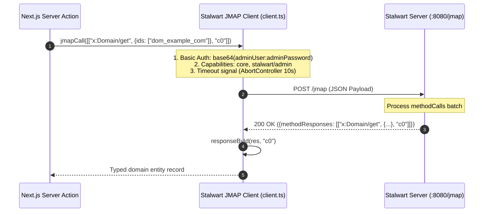

# 05 - Stalwart Mail Server Integration

## 1. Overview & Protocol Specification

[Stalwart Mail Server](https://stalw.art/) is an open-source, all-in-one mail server written in Rust that supports JMAP, IMAP, SMTP, ManageSieve, ACME, and directory authentication.

**mailwart** interfaces with Stalwart v0.16.x+ using the standard **JMAP (JSON Meta Application Protocol)** protocol at the endpoint `STALWART_JMAP_URL` (typically `http://stalwart-mail:8080/jmap` in-cluster or `https://mail.example.com/jmap`).

All management requests declare two JMAP capabilities:
- `urn:ietf:params:jmap:core` (RFC 8620)
- `https://stalw.art/jmap/admin/` (Stalwart administrative directory & MTA management extensions)

---

## 2. JMAP Client Architecture (`src/lib/stalwart/client.ts`)



JMAP calls are executed server-side via `jmapCall()` using Node's native `fetch` with strict timeout controls:

```typescript
export async function jmapCall(
  methodCalls: JmapMethodCall[],
  options: JmapClientOptions = {}
): Promise<JmapResponse> {
  const config = getStalwartConfig()
  // Authenticates with Basic base64(adminUser:adminPassword)
  const res = await fetch(config.jmapUrl, {
    method: "POST",
    headers: {
      Authorization: basicAuthHeader(config.adminUser, config.adminPassword),
      "Content-Type": "application/json",
    },
    body: JSON.stringify({
      using: ["urn:ietf:params:jmap:core", "https://stalw.art/jmap/admin/"],
      methodCalls,
    }),
    signal: controller.signal,
    cache: "no-store",
  })
  ...
}
```

### JMAP Call Structure
Each method invocation in `methodCalls` is a 3-element tuple:
`[MethodName, ArgumentsObject, CallId]`

Example:
```json
[
  "x:Domain/get",
  {
    "ids": ["dom_example_com"]
  },
  "c0"
]
```

### Response Parsing & ID Matching (`responseById`)
JMAP batches multiple method responses into `methodResponses`. The helper `responseById(res, callId)` extracts the exact result matching the original `callId`:
```typescript
const [name, data] = responseById(res, "c0")
if (name === "error") throw mapHttpError(500, data)
```

---

## 3. Entity Models & Data Normalization

### 3.1 Domains (`x:Domain`)
Managed via `src/lib/stalwart/domains.ts`:

| Stalwart Attribute | TypeScript Type | Description |
| :--- | :--- | :--- |
| `name` | `string` | Fully qualified domain name (e.g. `example.com`). |
| `description` | `string` | Administrative notes or label. |
| `isEnabled` | `boolean` | When `false`, Stalwart rejects incoming mail and blocks authentication. |
| `catchAllAddress`| `string \| null`| Fallback email address for unrouted local parts. |
| `allowRelaying` | `boolean` | When `true`, enables backup/split MX relaying for unknown users. |
| `subAddressing` | `string` | Sub-addressing delimiter (e.g. `+` for `user+tag@domain`). |

#### CRUD Method Calls
- **Query:** `["x:Domain/query", { "filter": {} }, "c0"]`
- **Get:** `["x:Domain/get", { "ids": ["dom_123"] }, "c1"]`
- **Set (Create):** `["x:Domain/set", { "create": { "k1": { ... } } }, "c2"]`
- **Set (Update):** `["x:Domain/set", { "update": { "dom_123": { ... } } }, "c3"]`
- **Set (Destroy):** `["x:Domain/set", { "destroy": ["dom_123"] }, "c4"]`

---

### 3.2 Accounts / Mailboxes (`x:Account`)
Managed via `src/lib/stalwart/accounts.ts`:

| Stalwart Attribute | TypeScript Type | Description |
| :--- | :--- | :--- |
| `email` | `string` | Primary email address (`user@domain.com`). |
| `name` | `string` | User display name / local-part. |
| `secrets` | `object` | Holds password hashes or clear credentials on creation. |
| `quotas` | `object` | Storage quotas map: `{ maxDiskQuota: number }` or `{}`. |
| `isEnabled` | `boolean` | Account active or suspended state. |
| `roles` | `string[]` | Account permissions (e.g. `["user"]`). |

#### Storage Quota Architecture & Normalization
Stalwart's JMAP schema strictly expects the key **`maxDiskQuota`** (an integer byte count) inside the `quotas` dictionary:
- **Set quota:** `quotas: { maxDiskQuota: 2147483648 }` (e.g. 2 GB)
- **Unmetered / Infinite:** `quotas: {}`

```typescript
export function normalizeQuotasForStalwart(
  quotas?: Record<string, unknown> | null
): Record<string, number> {
  if (!quotas || typeof quotas !== "object") return {}
  const candidate = quotas.maxDiskQuota ?? quotas.diskQuota ?? quotas.storage
  if (typeof candidate === "number" && Number.isFinite(candidate) && candidate > 0) {
    return { maxDiskQuota: Math.round(candidate) }
  }
  return {}
}
```

> [!NOTE]
> Passing unauthorized keys (such as `diskQuota`) causes Stalwart's schema validator to reject the request with:  
> `invalidPatch: Invalid key for object property`.  
> The `normalizeQuotasForStalwart()` sanitizer ensures every creation, update, and bulk patch payload is fully compliant.

#### Infinite Capacity & Dynamic 0.25GB Meter Scaling
- **Default:** All newly created and default mailboxes have unmetered capacity (`DEFAULT_MAILBOX_QUOTA_BYTES = null`).
- **Overview Scaling Meter:** To ensure the global storage meter on the dashboard displays meaningful progress without an arbitrary cap, infinite mailboxes dynamically scale their allocated contribution using `scaleInfiniteMailboxQuota(usedBytes)`:
  - $le 0.25	ext{ GB used} implies 0.25	ext{ GB allocated}$
  - Scales up in $0.25	ext{ GB}$ increments ($0.50	ext{ GB}$, $0.75	ext{ GB}$, $1.00	ext{ GB}$, $1.25	ext{ GB}$, etc.) as disk usage grows.

---

### 3.3 Email Aliases & Forwarding
- **Inbound Aliases:** Saved on the `x:Account` object under `aliases`. Normalizer `parseEmailAliases()` and serializer `serializeEmailAliases()` ensure local-parts are correctly combined with the parent domain name.
- **Outbound Forwarders:** Implemented either as Sieve redirect rules or Stalwart alias expansions, with target loop detection to prevent infinite forwarding loops.

---

### 3.4 Catch-All & Archival Journaling Architecture (`src/lib/stalwart/catchall.ts` & `sieve-generator.ts`)

Stalwart provides native catch-all routing on the domain level:
1. **Address Mode:** `catchAllAddress` is set to an existing mailbox (e.g. `catch@example.com`). Unrouted mail lands in this mailbox.
2. **Bounce Mode:** `catchAllAddress` is set to `null`. Unknown recipients are rejected at SMTP with `550 User unknown`.
3. **Blackhole Mode:** Drops unrouted mail silently.

#### Archival Mirroring
When Archival Mirroring is enabled (active by default for all domains), every email delivered to any mailbox on the domain automatically mirrors a copy into the catch-all address via Sieve.

#### 3-Tier Sieve Rule Architecture
Mailwart generates clean, RFC 5228 compliant ManageSieve scripts across all domain mailboxes:

```sieve
# -------------------------------------------------------------
# 0. Postmaster Traffic Filter (on catch-all mailbox)
# Drop DMARC / TLS-RPT / postmaster reports arriving at catch-all
# -------------------------------------------------------------
if anyof (
  envelope :matches "to" "postmaster@*",
  envelope :matches "to" "mailer-daemon@*",
  header :matches "to" "postmaster@*",
  header :matches "to" "mailer-daemon@*",
  header :contains "subject" "Report Domain:",
  header :contains "subject" "DMARC",
  header :contains "subject" "SMTP TLS Reporting"
) {
  discard;
  stop;
}

# -------------------------------------------------------------
# 1. User Inbound Forwarding Rules
# -------------------------------------------------------------
if envelope :matches "to" "me@example.com" {
  redirect :copy "external@gmail.com";
}

# -------------------------------------------------------------
# 2. Archival Journaling Copy (Catch-All)
# -------------------------------------------------------------
if not anyof (
  envelope :matches "to" "postmaster@*",
  envelope :matches "to" "mailer-daemon@*",
  header :matches "to" "postmaster@*",
  header :contains "subject" "Report Domain:",
  header :contains "subject" "DMARC",
  header :contains "subject" "SMTP TLS Reporting"
) {
  redirect :copy "catch@example.com";
}
```

---

### 3.5 Postmaster Purge System Abstraction (`src/lib/stalwart/postmaster-filter.ts`)

Because automated DMARC, TLS-RPT, and NDR messages sent to `postmaster@domain` can clutter catch-all inboxes before filtering is established, mailwart includes a retroactive cleanup engine:
- Queries messages in catch-all inboxes via JMAP `Email/query` targeting postmaster recipients and report subjects.
- Invokes `Email/set` with `destroy: [ids...]` to delete orphaned report messages.
- Exposed as an on-demand **Purge old reports** action in `/dashboard/routing`.

---

### 3.6 Application Passwords (`src/lib/stalwart/app-passwords.ts`)
Stalwart supports application-specific passwords allowing third-party email clients (Thunderbird, iOS Mail, Outlook) to connect without using the master account password.
- **Method:** `x:AppPassword/set`
- Mints a cryptographically secure 16-character random token.
- Associates an operator label (e.g. "MacBook Pro Mail.app").
- Passwords can be revoked at any time from `/dashboard/mailboxes/[id]`.

---

## 4. In-Memory Mock Store (`src/lib/stalwart/mock.ts`)

When Stalwart credentials are not present in `.env.local` or environment variables, mailwart boots in `mock` mode.

### Mock Store Capabilities:
- Stateful in-memory database holding pre-seeded domains (`example.com`, `example.net`, `example.org`, `internal.test`).
- Mock accounts (`admin@example.com`, `ops@example.com`, `hello@example.com`) with unmetered infinite capacity and randomized usage.
- Dynamic 0.25GB scaling metrics on mock overview statistics.
- Simulated delivery traces and audit events.
- Allows full interactive testing of the UI, wizards, and Copilot tools without network dependencies.
