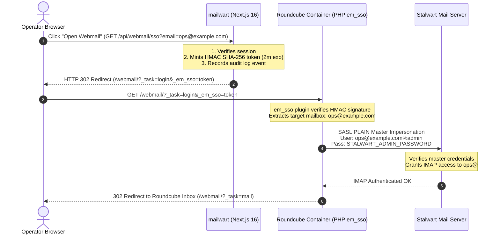

# 06 - Roundcube Webmail & Single Sign-On (SSO)

## 1. Overview & Architecture

**Roundcube** is the integrated webmail surface for **mailwart**. Rather than forcing administrators to ask users for passwords or store mailbox passwords in plaintext, mailwart implements a **zero-password Single Sign-On (SSO)** architecture.

An operator clicks "Webmail" anywhere in mailwart, and Roundcube opens authenticated as that mailbox in under two seconds.



---

## 2. Cryptographic Token Specification (`src/lib/webmail-sso.ts`)

The SSO token is a compact, URL-safe base64-encoded signed payload generated server-side:

```typescript
export function createWebmailSsoToken(email: string): string {
  const secret = getWebmailSsoSecret()
  const payload = {
    email: email.trim().toLowerCase(),
    iat: Math.floor(Date.now() / 1000),
    exp: Math.floor(Date.now() / 1000) + 120, // 2-minute lifetime
    nonce: randomBytes(16).toString("hex"),
    aud: "roundcube",
  }

  const encodedPayload = Buffer.from(JSON.stringify(payload)).toString("base64url")
  const signature = createHmac("sha256", secret)
    .update(encodedPayload)
    .digest("base64url")

  return `${encodedPayload}.${signature}`
}
```

### Security Properties
1. **Short-Lived (120s TTL):** Tokens expire 2 minutes after creation, mitigating replay attacks.
2. **Replay Defense (Nonce):** Each minted token contains a cryptographically random 16-byte nonce.
3. **Audience Restricted (`aud: "roundcube"`):** Tokens cannot be accepted by any other service.
4. **HMAC SHA-256 Signature:** Sealed with `WEBMAIL_SSO_SECRET` (minimum 32 random characters).

---

## 3. The `em_sso` Roundcube Plugin (`roundcube/plugins/em_sso/em_sso.php`)

The custom Roundcube PHP plugin registers four hooks in Roundcube's lifecycle:

### Hook 1: `startup`
- Checks for query parameter `_em_sso`.
- Validates the token's HMAC signature and checks `exp > time()`.
- Drops any pre-existing Roundcube session (`rcmail::get_instance()->kill_session()`) to ensure that switching between mailboxes does not reuse cached identities.
- Sets `$args['task'] = 'login'` and `$args['action'] = 'login'` to force Roundcube into the authentication pipeline.

### Hook 2: `authenticate`
- Retrieves the verified target mailbox email (e.g. `ops@example.com`).
- Reads the server-side impersonator credentials (`WEBMAIL_IMPERSONATOR_PASSWORD`).
- Sets `$args['user'] = $target` and `$args['pass'] = $password`.
- Bypasses cookie checks: `$args['cookiecheck'] = false; $args['valid'] = true;`.

### Hook 3: `storage_connect` (IMAP)
When Roundcube establishes an IMAP connection to Stalwart (`ssl://stalwart-mail:993`):
- Rewrites the IMAP authentication username to use **Stalwart SASL Impersonation syntax**:
  ```php
  $args['user'] = $target . '%' . $impersonator;
  $args['pass'] = $password;
  ```
- Stalwart recognizes the `%` delimiter, validates the impersonator's credentials, and maps the session directly to the target mailbox without needing the user's personal password.

### Hook 4: `smtp_connect` (SMTP)
When sending outbound email from the webmail client:
- Rewrites SMTP authentication credentials to:
  ```php
  $args['smtp_user'] = $target . '%' . $impersonator;
  $args['smtp_pass'] = $password;
  ```
- Allows the user to send messages authentically with proper DKIM signing from their address.

---

## 4. Roundcube Container & Environment (`docker-compose.yml`)

The Roundcube container is built from `roundcube/Dockerfile` with plugins:
`ROUNDCUBEMAIL_PLUGINS: archive,zipdownload,managesieve,em_sso`

### Environment Variables
| Variable | Description |
| :--- | :--- |
| `ROUNDCUBEMAIL_DEFAULT_HOST` | `ssl://stalwart-mail:993` (in-cluster IMAP SSL) |
| `ROUNDCUBEMAIL_SMTP_SERVER` | `tls://stalwart-mail:587` (in-cluster SMTP TLS) |
| `ROUNDCUBEMAIL_MANAGESIEVE_HOST` | `tls://stalwart-mail:4190` (Sieve filter editing) |
| `ROUNDCUBEMAIL_DES_KEY` | 24-character encryption key for Roundcube session storage |
| `WEBMAIL_SSO_SECRET` | Shared secret matching mailwart's `WEBMAIL_SSO_SECRET` |
| `WEBMAIL_IMPERSONATOR_USER` | Admin user with impersonate rights (default: `STALWART_ADMIN_USER`) |
| `WEBMAIL_IMPERSONATOR_PASSWORD` | Password matching `STALWART_ADMIN_PASSWORD` |

---

## 5. Reverse Proxy Routing (Traefik)

Traefik provides flexible ingress rules:
1. **Sub-path Ingress:** `Host('email.yehia.dev') && PathPrefix('/webmail')` strips `/webmail` and routes to `roundcube:80`.
2. **Dedicated Host Ingress:** Any domain matching `webmail.*` or `mail.zokm.me` routes directly to `roundcube:80` without path rewriting, enabling clean customized URLs for client domains (e.g. `https://webmail.clientdomain.com`).
