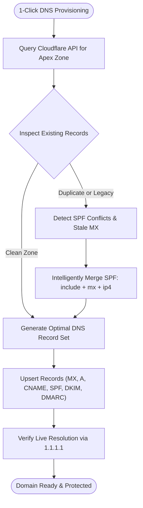

# 07 - Cloudflare DNS Automation

## 1. Overview & Capabilities

Configuring mail records (MX, SPF, DKIM, DMARC) across multiple DNS providers is typically error-prone and tedious. **mailwart** includes a full-featured **Cloudflare DNS Automation Engine** (`src/lib/cloudflare/`) that connects to one or more Cloudflare accounts to:

- Discover DNS zones across linked accounts automatically.
- Detect DNS record conflicts (e.g., duplicate SPF records, stale MX pointers).
- Automatically provision complete, production-grade email DNS records with one click.
- Intelligently merge existing SPF policies with Stalwart's IP and MX mechanisms.
- Propagate webmail CNAME/A records across all hosted zones.
- Continuously verify live propagation using direct public recursive resolvers.

---

## 2. Multi-Account Token Pooling (`src/lib/cloudflare/settings-store.ts`)

Mailwart supports pooling multiple Cloudflare accounts simultaneously:

```typescript
export type CloudflareAccountConfig = {
  id: string
  userId?: string
  accountName: string
  accountId?: string
  apiToken: string
  lastVerifiedAt?: string
  zonesCount?: number
  status: "active" | "error" | "rate_limited"
  errorMessage?: string
}
```

### Storage & Encryption
- Tokens are stored in PostgreSQL (`cloudflare_accounts` table) or encrypted JSON (`/data/cloudflare-settings.json`).
- Environment variable `CLOUDFLARE_API_TOKEN` is automatically incorporated as the default system-level account.
- Administrators can audit, test, and register multiple client or corporate Cloudflare accounts.

---

## 3. Automated Zone Discovery & Matching (`src/lib/cloudflare/client.ts`)

When a domain (e.g. `sub.example.com` or `example.com`) is added:
1. Mailwart queries the Cloudflare v4 REST API (`GET /client/v4/zones?per_page=50`) across all active linked accounts.
2. The resolver matches the domain to the most specific apex zone available.
3. Zone status (active, pending, paused) and permissions (`Zone:DNS:Edit`) are cached and verified.

---

## 4. One-Click Provisioning Engine (`provisionDomainDns`)



When an operator provisions a domain, mailwart automatically synchronizes 6 critical DNS records:

| Record Type | Record Name | TTL / Priority | Record Content | Purpose |
| :--- | :--- | :--- | :--- | :--- |
| `MX` | `example.com` | Priority: 10 | `mail.example.com` | Mail Exchanger routing |
| `A` | `mail.example.com` | DNS-only (Auto) | `<VPS_PUBLIC_IP>` (23.94...) | Direct SMTP / IMAP socket |
| `CNAME` | `webmail.example.com` | Proxied | `email.yehia.dev` | Ingress for user webmail |
| `TXT` | `example.com` (SPF) | Auto | `v=spf1 mx ip4:<SERVER_IP> ~all` | Sender Policy Framework |
| `TXT` | `<selector>._domainkey.example` | Auto | `v=DKIM1; k=rsa; p=MII...` | 2048-bit DKIM signature key |
| `TXT` | `_dmarc.example.com` | Auto | `v=DMARC1; p=reject; rua=mailto:...` | Domain authentication policy |

### 1. Mail Exchanger (MX)
- Points to `mail.<domain>` with priority `10`.
- Replaces any lingering legacy mail exchanger records if confirmed by the operator.

### 2. Direct Mail Exchanger Host (A Record)
- Resolves `mail.<domain>` directly to the server's public IP address (`SERVER_PUBLIC_IP`).
- **Proxy Status:** Always forced to `proxied: false` (DNS-only) because Cloudflare HTTP proxying blocks raw SMTP/IMAP traffic on non-HTTP ports.

### 3. Webmail Ingress (CNAME)
- Sets `webmail.<domain>` pointing to the mailwart deployment host.
- Can be proxied by Cloudflare (`proxied: true`) to leverage Cloudflare DDoS protection and SSL termination.

### 4. Intelligent SPF Merging (`src/lib/cloudflare/detect.ts`)
RFC 7208 forbids publishing multiple SPF TXT records on a single domain. If a domain already has an existing SPF record (e.g. sending via Google Workspace or SendGrid):
- Mailwart extracts the existing mechanisms (`include:_spf.google.com`).
- Appends Stalwart's `mx` and `ip4:<SERVER_IP>` mechanisms.
- Normalizes qualifiers to `~all` or `-all`.
- Updates the existing record in-place rather than creating an invalid second record.

### 5. Live Stalwart DKIM Key Generation
- Queries Stalwart JMAP for active DKIM signatures associated with the domain.
- If no signature exists, calls `generateDkimAction` to generate a new 2048-bit RSA key pair in Stalwart.
- Formats and creates the public key record: `<selector>._domainkey.<domain>`.

### 6. RFC 7489 Compliant DMARC Policy
- Deploys a baseline policy: `v=DMARC1; p=reject; sp=reject; pct=100; rua=mailto:dmarc@<domain>`.

---

## 5. Live Public DNS Verification (`src/lib/dns/check.ts`)

Standard DNS lookups inside Docker containers can be misleading due to Docker's internal 127.0.0.11 DNS caching proxy.

Mailwart deploys a dedicated public `Resolver` instance querying Cloudflare (`1.1.1.1`, `1.0.0.1`) and Google (`8.8.8.8`, `8.8.4.4`) directly:

```typescript
const publicResolver = new Resolver({ timeout: 3500, tries: 2 })
publicResolver.setServers(["1.1.1.1", "1.0.0.1", "8.8.8.8", "8.8.4.4"])
```

### Health Rubric
| Status | Meaning |
| :--- | :--- |
| `pass` | All 4 records (MX, SPF, DKIM, DMARC) match server expectations exactly. |
| `propagating` | Records are published in Cloudflare but have not fully propagated to external root nameservers. |
| `warn` | Optional mechanisms missing or SPF qualifier is relaxed (`?all`). |
| `fail` | Missing MX or SPF records; mail cannot be delivered or will be flagged as spam. |
