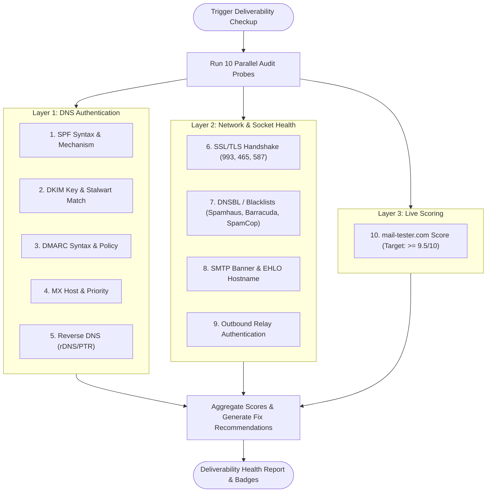

# 08 - Email Deliverability Suite

## 1. Overview & Purpose

Ensuring that outbound email reaches the inbox rather than the spam folder requires precision across DNS authentication, server reputation, TLS certificates, and MTA handshake banners.

**mailwart** includes an in-depth **10-Point Email Deliverability Engine** (`src/lib/deliverability/`) that continuously monitors domain authentication, server IP reputation across public blacklists (RBLs), network socket connectivity, and benchmark comparisons against traditional cPanel email servers.

---

## 2. The 10-Point Deliverability Inspection Engine



When an operator triggers a deliverability checkup from the dashboard or API, the engine runs ten parallel audits across all managed domains:

| # | Inspection Target | Evaluation Method | Passing Criteria |
| :-: | :--- | :--- | :--- |
| **1** | **SPF Record Syntax** | Public DNS TXT query | Single record, valid mechanisms, `~all` or `-all` qualifier |
| **2** | **DKIM Cryptographic Key** | Selector DNS TXT + Stalwart match | 2048-bit RSA/Ed25519 public key published and valid |
| **3** | **DMARC Compliance** | `_dmarc` DNS query | Valid syntax, `p=reject` or `p=quarantine`, `rua` mailbox set |
| **4** | **MX Host Validation** | DNS MX query | Resolves to valid FQDN, priority >= 10 |
| **5** | **Reverse DNS (rDNS / PTR)** | Reverse IP query (`.in-addr.arpa`) | PTR record matches outgoing mail server FQDN |
| **6** | **SSL / TLS Handshake** | Native TLS probe (993, 465, 587) | Valid unexpired TLS certificate on IMAP & SMTP ports |
| **7** | **DNSBL / RBL Blacklists** | Reverse IP query on 3+ RBLs | Not listed on Spamhaus, Barracuda, or SpamCop |
| **8** | **SMTP Banner & EHLO** | Raw TCP probe on port 25/587 | Clean 220 banner, FQDN matches mail server hostname |
| **9** | **Outbound Relay Auth** | SMTP AUTH test | Requires authentication for non-local relaying |
| **10** | **Third-Party Spam Score** | mail-tester API & scraper | Scored >= 9.5 / 10 on live test messages |

---

## 3. Deep-Dive Inspection Modules

### 3.1 DNSBL / Blacklist Monitoring (`KNOWN_DNSBLS`)
The engine reverses the server's public IPv4 address (`23.94.107.153` &rarr; `153.107.94.23`) and queries major public reputation DNSBLs:
- `zen.spamhaus.org` (Spamhaus SBL, XBL, PBL composite)
- `b.barracudacentral.org` (Barracuda Reputation Network)
- `bl.spamcop.net` (SpamCop Blocking List)

If a query returns an `A` record matching `127.0.0.x`, the engine extracts the specific sub-list code, issues an immediate red alert badge, and provides the direct delisting URL.

### 3.2 Port Connectivity & TLS Handshake Probes (`probePort`)
Using Node's native `net` and `tls` modules, mailwart initiates real network connections to verify socket health:
- **Port 993 (IMAP SSL):** Full TLS handshake verification and latency measurement.
- **Port 587 (SMTP Submission):** Connects, reads the 220 banner, and executes STARTTLS upgrade.
- **Port 465 (SMTPS):** Verifies implicit TLS socket and certificate validity.
- **Port 4190 (ManageSieve):** Checks Sieve filter protocol daemon reachability.

### 3.3 Reverse DNS / PTR Verification
Major mail receivers (Google Gmail, Microsoft Outlook, Yahoo) immediately discard or throttle messages from IP addresses lacking a valid reverse DNS (PTR) record.
- Resolves `153.107.94.23.in-addr.arpa` to obtain the PTR hostname.
- Performs a forward DNS lookup on that hostname to verify **Forward-Confirmed Reverse DNS (FCrDNS)**.

---

## 4. Dedicated Test Mailboxes (`ensureMailboxesOnAllDomains`)

To test outbound deliverability automatically without using sensitive personal user accounts, mailwart provisions dedicated deliverability mailboxes:
- Format: `test@<domain>` (e.g., `test@example.com` or `deliv-test@example.com`).
- Configured with unlimited quotas and automated credentials.
- Used to transmit test emails to external mail reflection and scoring services.

---

## 5. Scoring Algorithm & Historical Storage

### Score Calculation
The overall score is calculated on a 10-point scale:
- DNS Authentication (SPF, DKIM, DMARC, MX): **4.0 points**
- Network & TLS Security (Ports, SSL, PTR): **3.0 points**
- IP Reputation (Clean DNSBLs): **2.0 points**
- Banner & EHLO Conformity: **1.0 point**

### Report Persistence (`src/lib/deliverability/store.ts`)
Each audit creates an entry in the `deliverability_reports` table in PostgreSQL:
```sql
CREATE TABLE IF NOT EXISTS deliverability_reports (
  id VARCHAR(64) PRIMARY KEY,
  user_id VARCHAR(64),
  overall_score INTEGER NOT NULL,
  total_domains INTEGER NOT NULL,
  report JSONB NOT NULL,
  created_at TIMESTAMPTZ NOT NULL DEFAULT NOW()
);
```
Operators can review historical score trends directly in `/dashboard/settings?tab=deliverability`.
