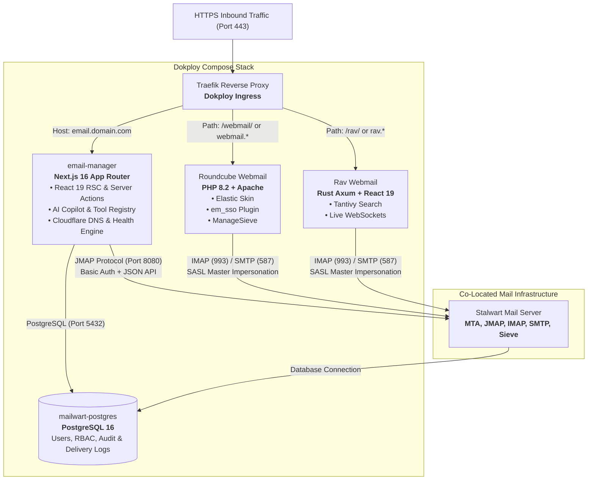

# mailwart - Technical Documentation

Welcome to the comprehensive technical documentation for **mailwart**, a modern, cPanel-grade Stalwart Mail Server & Roundcube Webmail management console with an integrated AI Copilot.

mailwart is built with **Next.js 16 (App Router)**, **React 19**, **Tailwind CSS v4**, **TypeScript**, and **PostgreSQL**, deployed via **Docker Compose** behind **Traefik** in Dokploy.

---

## Documentation Structure

This documentation directory is organized into modular guides covering every layer of the system:

| Guide | Title | Description |
| :--- | :--- | :--- |
| **[Getting Started Guide](/docs/get-started)** | **Getting Started Guide** | Step-by-step setup, local development, domain provisioning, and webmail SSO. |
| **[System Architecture](/docs/architecture)** | **System Architecture & Infrastructure** | Complete topology, container networking, runtime isolation, data flow lifecycles, and mock vs. live dual runtime engine. |
| **[Pages, Navigation & UX](/docs/pages-and-routes)** | **Frontend Pages, Navigation & UX** | Exhaustive mapping of all 11 UI pages, AppShell chrome, navigation sidebar, modals, wizards, and interactive components. |
| **[HTTP REST API Reference](/docs/api-reference)** | **HTTP API Endpoints** | Specifications for all Next.js API route handlers (`/api/auth`, `/api/copilot`, `/api/deliverability`, `/api/diagnostics`, `/api/webmail/sso`, etc.). |
| **[Server Actions Catalog](/docs/server-actions)** | **Server Actions Catalog** | In-depth technical catalog of all 80+ server actions across mail, users, Cloudflare, copilot, deliverability, and auth. |
| **[Stalwart Mail Server & JMAP](/docs/stalwart-integration)** | **Stalwart Mail Server Integration** | JMAP protocol specification, method calls, data normalization, catch-all handling, app passwords, and mock engine. |
| **[Roundcube Webmail SSO](/docs/roundcube-sso)** | **Roundcube Webmail & SSO** | Custom `em_sso` PHP plugin, HMAC SHA-256 token minting, master impersonation protocol (`user%impersonator`), and Traefik routing. |
| **[Cloudflare DNS Automation](/docs/cloudflare-automation)** | **Cloudflare DNS Automation** | Multi-account token pooling, automated zone discovery, 1-click DNS record provisioning (MX, SPF, DKIM, DMARC), and conflict detection. |
| **[Deliverability Suite](/docs/deliverability-suite)** | **Email Deliverability Suite** | 10-point deliverability audit engine, port & TLS probes, DNSBL blacklist monitoring, SMTP banner & EHLO checks, and mail-tester scoring. |
| **[AI Copilot & Tool Registry](/docs/ai-copilot)** | **AI Copilot & Tool Registry** | Architecture with Vercel AI SDK, 10 supported LLM providers, 48 registered administrative tools, and human-in-the-loop approval workflows. |
| **[Database, Security & Deployment](/docs/database-and-security)** | **Database, Security & Deployment** | PostgreSQL 12-table schema, iron-session encryption, RBAC, operator impersonation, OTP recovery, audit logging, and Dokploy deployment. |
| **[Rav Webmail & Dual Engine](/docs/rav-webmail)** | **Rav Webmail & Dual-Engine Architecture** | Next.js 16 + React 19 + Rust Axum webmail, Tantivy search, live WebSockets, and dual SSO. |

---

## High-Level System Architecture



---

## Core Product Principles

1. **Stalwart is the Source of Truth:** Mailbox existence, domain states, catch-all configurations, and email routing are always verified against Stalwart JMAP. The local PostgreSQL database mirrors directory state to power RBAC domain ownership and cached analytics without desynchronizing from the server.
2. **Zero Plaintext Mailbox Passwords in Browser:** User mailbox passwords are generated or reset in single-flight operations. When opening webmail, administrators never enter or view the mailbox password - short-lived signed HMAC tokens and Stalwart SASL PLAIN master impersonation handle authentication transparently.
3. **Graceful Fallback & Mock Runtime:** If Stalwart or PostgreSQL credentials are unset (e.g. during local frontend development or automated testing), the application boots cleanly in `mock` mode with a stateful in-memory directory store.
4. **Strict Isolation & Safe Operations:** Destructive actions (deleting domains, removing mailboxes, mass password resets) require explicit typed confirmations or operator approval modals in the AI Copilot.

---

## Quick Reference Commands

```bash
# Install dependencies
npm install

# Start development server
npm run dev

# Run type check
npm run typecheck

# Run linter
npm run lint

# Run test suite (Vitest)
npm test

# Build production bundle
npm run build
```
